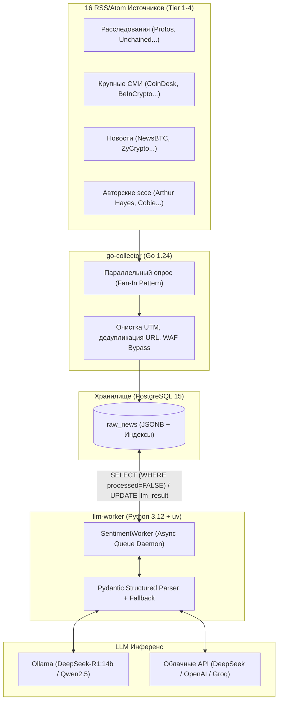

# 🚀 Sentix — Quantitative Financial NLP & Market Event Study Engine

Высокопроизводительный аналитический комплекс **Sentix** для автоматизированного сбора, дедупликации, глубокого финансового NLP-анализа новостей и квантитативной валидации рыночной реакции котировок (Event Study) в реальном времени.

---

## 🏗 Архитектура системы

Комплекс построен по микросервисной архитектуре и состоит из трех ключевых компонентов, объединенных через Docker Compose:



1. **[`go-collector`](file:///Users/isnov/Documents/Git/news-analysis/go-collector/README.md) (Go 1.24):**
   * Конкурентный сборщик на горутинах (паттерн Fan-In).
   * Опрос 16 очищенных авторитетных источников с извлечением полного текста (`content:encoded`).
   * Нормализация URL (удаление UTM-меток, трекеров) и дедупликация на уровне БД (`ON CONFLICT (url) DO NOTHING`).
   * Обход WAF-защиты (Cloudflare, Sucuri) через эмуляцию Desktop User-Agent.

2. **`db` (PostgreSQL 15):**
   * Центральное хранилище сырых статей и результатов квантитативной разметки.
   * Партиционированный индекс `idx_raw_news_queue` по `(timestamp_utc ASC) WHERE processed = FALSE AND (locked_until IS NULL OR locked_until < NOW())` для мгновенной бесколлизионной выборки статей распределенными воркерами.
   * Поле `llm_result JSONB` для гибкого хранения структурированного отчета.
   * Централизованные версионированные миграции схемы через [`migrations/`](file:///Users/isnov/Documents/Git/news-analysis/migrations) и команду `make db-migrate`.

3. **[`llm`](file:///Users/isnov/Documents/Git/news-analysis/llm/README.md) (Python 3.12 + uv):**
   * Распределенный асинхронный воркер (`SentimentWorker`) с атомарным захватом очереди (`FOR UPDATE SKIP LOCKED`) и поддержкой горизонтального масштабирования на любое число инстансов.
   * Гарантированная Pydantic-валидация через OpenAI-совместимый протокол Structured Outputs.
   * Поддержка цепочек рассуждений моделей DeepSeek-R1 (автоматическое извлечение и изоляция блоков `<think>...</think>`).
   * Внешние `.sql` файлы для работы с БД через пул соединений `psycopg3`.

4. **[`market-evaluator`](file:///Users/isnov/Documents/Git/news-analysis/market-evaluator/README.md) (Python 3.12 + uv):**
   * Микросервис квантитативного анализа рыночной реакции котировок (Event Study Engine).
   * Автоматическая выгрузка OHLCV-свечей с публичного API Binance вокруг времени публикации статьи ($t_0 - 4\text{ч} \dots t_0 + 24\text{ч}$).
   * Расчет доходностей (+15м, +1ч, +4ч, +24ч), пре-новостных утечек (Pre-event Drift), всплесков объемов и просадок.
   * Автоматическая валидация прогнозов LLM (Win Rate / Directional Alignment) с записью в таблицу `news_market_impact`.

> 📖 Подробное описание сквозного пайплайна и схемы БД см. в [**`docs/ARCHITECTURE.md`**](file:///Users/isnov/Documents/Git/news-analysis/docs/ARCHITECTURE.md).  
> 🗺 Дорожную карту развития (рынок РФ, Telegram-пампы, мульти-LLM и алгобот) см. в [**`ROADMAP.md`**](file:///Users/isnov/Documents/Git/news-analysis/ROADMAP.md).

---

## 📊 Научная схема анализа сентимента

В отличие от примитивной трехклассовой классификации (positive/negative/neutral), сервис формирует **11-мерный квантитативный профиль** каждой новости:

| Параметр | Тип | Описание |
| :--- | :--- | :--- |
| **`sentiment_score`** | `float [-1.0 .. +1.0]` | Числовой вектор влияния на баланс спроса и предложения. |
| **`sentiment_label`** | `enum` | Категория: `bullish`, `bearish`, `neutral`. |
| **`confidence`** | `float [0.0 .. 1.0]` | Степень статистической уверенности модели в оценке. |
| **`impact_magnitude`** | `int [1 .. 10]` | Сила рыночного шока: от 1 (локальный шум) до 10 (события масштаба ETF/FTX). |
| **`time_horizon`** | `enum` | Временной лаг: `immediate_1h_4h`, `short_term_1d_3d`, `medium_term_1w_1m`, `long_term_months`. |
| **`information_type`** | `enum` | Природа данных: `hard_fact`, `rumor_leak`, `opinion_analysis`, `macro_release`. |
| **`market_surprise`** | `enum` | Фактор неожиданности: `better_than_expected`, `worse_than_expected`, `in_line`, `not_applicable`. |
| **`transmission_channel`** | `enum` | Макро-канал: `liquidity_and_rates`, `fiat_debasement`, `geopolitical_risk`, `regulatory`, `defi_tech_exploit`, `general_crypto`. |
| **`affected_assets`** | `array` | Список затронутых тикеров (`BTC`, `ETH`, `SOL`...) с индивидуальным сентиментом и причиной. |
| **`key_takeaways`** | `array[str]` | 2–3 главных тезиса новости без «воды». |
| **`reasoning`** | `string` | Экономическое обоснование (Chain-of-Thought) механизма передачи импульса. |

---

## 🌐 Источники данных (16 каналов)

Все источники прошли верификацию на отсутствие спама, реферальных ссылок и доступность полных текстов статей:

* **Tier 1 (Глубокие расследования и аналитика):** `Protos`, `Unchained Crypto` (Laura Shin), `Bitcoin Magazine`, `Smart Liquidity`.
* **Tier 2 (Крупнейшие медиа-издания):** `BeInCrypto`, `CryptoSlate`, `The Daily Hodl`, `Blockonomi`, `Finbold`, `Coinspeaker`.
* **Tier 3 (Новостные порталы):** `Bitcoinist`, `NewsBTC`, `CoinJournal`, `ZyCrypto`, `BitcoinWorld`, `NullTX`.
* **Tier 4 (Авторские эссе лидеров мнений):** `Arthur Hayes (Substack)`, `Cobie (Substack)`.

---

## ⚡️ Быстрый старт

### Требования

* **Docker** и **Docker Compose**
* **Один из вариантов инференса LLM:**
  * **Вариант А (Рекомендуется — облачный Groq):** Бесплатный API-ключ Groq (`gsk_...`), дающий скорость ~2.5 сек на статью на модели `qwen/qwen3.8-27b` без нагрузки на ваш компьютер.
  * **Вариант Б (Локальный — Ollama):** Локально установленная Ollama на хосте (Mac/Linux) с загруженной моделью:
    ```bash
    ollama run deepseek-r1:14b
    ```

### 1. Клонирование и настройка окружения

```bash
# Клонируйте репозиторий
git clone https://github.com/Isn0v/news-analysis.git
cd news-analysis

# Создайте файл окружения из шаблона
cp .env.example .env
```

> 💡 **Для запуска через Groq:** откройте файл `.env` и укажите ваш ключ:
> ```bash
> GROQ_API_KEY=gsk_your_key_here
> LLM_MODEL=qwen/qwen3.8-27b
> ```

### 2. Запуск комплекса в Docker

```bash
# Запустите весь комплекс (PostgreSQL + Go Collector + LLM Worker)
make up
```

---

## ⚙️ Конфигурация (`.env` — Single Source of Truth)

Все настройки комплекса централизованы в корневом файле `.env` и автоматически пробрасываются в Docker Compose и Python-микросервисы:

| Переменная | По умолчанию | Описание |
| :--- | :--- | :--- |
| `POSTGRES_HOST` | `db` (docker) / `localhost` (local) | Хост базы данных PostgreSQL |
| `POSTGRES_PORT` | `5432` | Порт PostgreSQL |
| `POSTGRES_USER` | `trader` | Пользователь БД |
| `POSTGRES_PASSWORD` | `strongpassword` | Пароль БД |
| `POSTGRES_DB` | `crypto_news` | Имя базы данных |
| `LLM_BASE_URL` | `http://host.docker.internal:11434/v1` | URL OpenAI-совместимого эндпоинта LLM |
| `LLM_API_KEY` | `ollama` | API-ключ (для Ollama любое значение, для OpenAI/DeepSeek — реальный ключ) |
| `GROQ_API_KEY` | *(Опционально)* | API-ключ Groq Cloud (`gsk_...`). Автоматически переключает URL на Groq |
| `LLM_MODEL` | `deepseek-r1:14b` | Название модели (`qwen/qwen3.8-27b`, `deepseek-r1:14b`, `gpt-4o-mini` и др.) |
| `LLM_TEMPERATURE` | `0.1` | Температура генерации (минимальная для детерминированности) |
| `LLM_NUM_CTX` | `16384` | Размер контекстного окна токенов (Ollama) |
| `LLM_TIMEOUT` | `120.0` | Таймаут HTTP-запроса к модели в секундах |
| `BATCH_SIZE` | `3` | Количество новостей за один шаг выборки |
| `MAX_CONCURRENT_REQUESTS` | `2` | Количество параллельных запросов к LLM (Semaphore) |
| `MAX_CONTENT_CHARS` | `6000` | Максимальная длина статьи, передаваемая в промпт |
| `POLL_INTERVAL_SECONDS` | `10` | Пауза опроса очереди при отсутствии новых статей |
| `WORKER_ID` | Auto-generated (`worker-{host}-{uuid}`) | Идентификатор инстанса воркера для распределенной очереди |
| `LOCK_TIMEOUT_MINUTES` | `15` | Таймаут удержания блокировки статьи в минутах |
| `LOG_LEVEL` | `INFO` | Уровень логирования (`DEBUG`, `INFO`, `WARNING`, `ERROR`) |

---

## 🔬 Результаты квантитативного тестирования (Live Edge)

На реальном датасете рыночной валидации ($n = 128$ оценок по 87 уникальным новостям) получено статистическое подтверждение двух независимых рыночных аномалий:

* 🎯 **Momentum на твердых фактах (`factual_strong_signal_win_rate_pct`):** **73.0%** ($Z = 2.80, p = 0.00257$). Сильные фактические события (регуляторные вердикты, ETF, листинги) создают устойчивый направленный импульс на горизонте 1–4 часа.
* 🔄 **Fade / Mean-Reversion на спекулятивном шуме (`speculative_impulse_win_rate_pct`):** всего **16.4%** выживаемости импульса $\implies$ **83.6% вероятность полного затухания и отката цены** ($Z = 4.15, p = 0.000017$). Эмоциональные всплески на прогнозах аналитиков и слухах эффективно поглощаются лимитными ордерами маркетмейкеров.

> Подробная математика и метрики описаны в [`market-evaluator/README.md`](file:///Users/isnov/Documents/Git/news-analysis/market-evaluator/README.md).

---

## 🛠 Полезные команды (Makefile & Docker)

```bash
# Управление контейнерами
make up          # Собрать и запустить все контейнеры в фоне
make down        # Полная остановка с очисткой томов (volumes)
make stop        # Остановка контейнеров с сохранением данных в базе
make ps          # Проверить статус контейнеров

# Логи сервисов в реальном времени
docker compose logs -f llm           # Логи воркера сентимента
docker compose logs -f go-collector  # Логи сборщика новостей
docker compose logs -f market-evaluator # Логи валидатора рынка

# Квантитативная рыночная аналитика (Event Study)
make eval-stats  # Вывести институциональную таблицу Win Rate (Факты vs Спекуляции)
make eval-batch  # Пакетная валидация необработанных новостей на свечах Binance
make db-export   # Экспорт всех датасетов в CSV/JSON в папку ./exports/

# Управление базой данных и миграциями
make db-migrate  # Применить версионированные миграции из migrations/
make llm-reset   # Сбросить статус обработки новостей для повторного прогона

# Локальный инференс LLM (Apple Silicon & Ollama)
make mlx-serve          # Запустить нативный Apple MLX сервер Qwen 3.8 27B (порт 8080)
make qwen-ollama-setup  # Создать модель qwen-fast в Ollama (num_ctx 8192, temp 0.2)
make ollama-setup       # Настроить модель deepseek-r1:14b в Ollama (num_ctx 16k)

# Проверка качества кода и тесты
make lint        # Проверить код линтером (Go vet + Ruff)
make format      # Автоформатирование кода (Ruff format)
make test        # Запуск полного набора тестов (Go + LLM + Market Evaluator)
make test-llm    # Только тесты LLM-воркера
make test-eval   # Только тесты Market Evaluator
```

---

## 🔍 Полезные SQL-запросы для аналитики

Все вспомогательные аналитические запросы собраны в папках [`llm/sql/`](file:///Users/isnov/Documents/Git/news-analysis/llm/sql) и [`market-evaluator/sql/`](file:///Users/isnov/Documents/Git/news-analysis/market-evaluator/sql):

```bash
# Проверить количество обработанных и ожидающих новостей:
docker compose exec -T db psql -U trader -d crypto_news -f /dev/stdin < llm/sql/get_table_stats.sql

# Посмотреть последние 3 размеченные новости с полным JSON-сентиментом:
docker compose exec -T db psql -U trader -d crypto_news -c "
SELECT id, title, source, processed_at, jsonb_pretty(llm_result) 
FROM raw_news 
WHERE processed = TRUE 
ORDER BY processed_at DESC 
LIMIT 3;
"
```

---

## 💡 Особенности инференса на Apple Silicon vs Linux

В архитектуре проекта учтены фундаментальные особенности работы с локальными моделями:

* **На macOS (M-серия):** Docker работает внутри виртуальной машины Linux, куда закрытый графический стек **Apple Metal не пробрасывается**. Поэтому Ollama запускается **нативно на хосте**, отдавая всю мощь объединенной памяти GPU, а контейнеры Docker обращаются к ней через сетевой мост `host.docker.internal:11434`.
* **На Linux (с картами NVIDIA):** Ollama может быть без потерь скорости запущена в отдельном контейнере Docker через `nvidia-container-toolkit`.

---

## 📄 Лицензия и отказ от ответственности

* **Лицензия:** [Proprietary & Commercial Software License](file:///Users/isnov/Documents/Git/news-analysis/LICENSE). Все права защищены (Copyright © 2026 Isn0v). Копирование, распространение или коммерческая эксплуатация без письменного разрешения правообладателя строго запрещены.
* **Финансовый дисклеймер:** Комплекс Sentix предназначен исключительно для исследовательских, аналитических и статистических целей. Сигналы, сентимент-оценки и метрики Event Study **не являются индивидуальной инвестиционной рекомендацией (ИИР)**. Автор не несет ответственности за торговые решения, финансовые убытки или издержки, возникшие при использовании сервиса.
