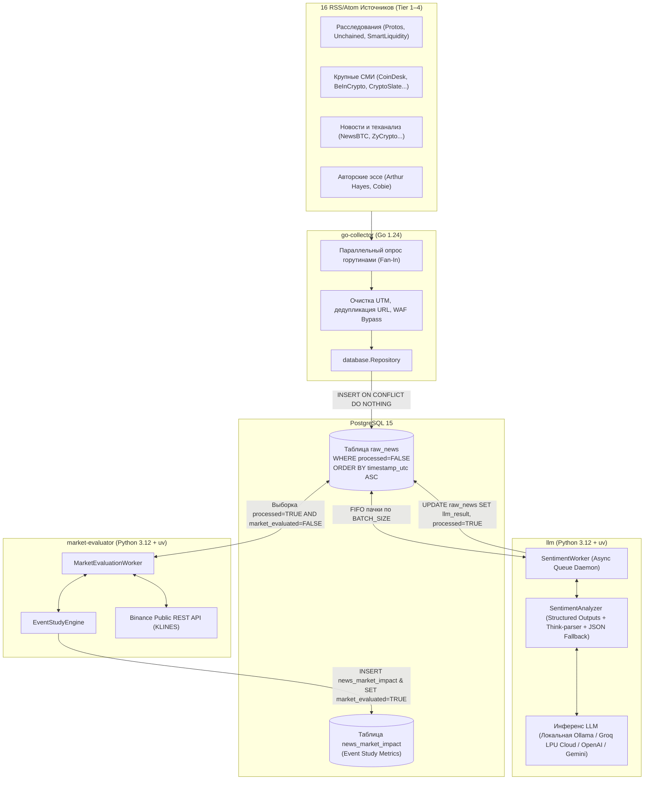

# 🏗 Архитектура системы News Analysis & Crypto Sentiment Engine

Высокопроизводительный микросервисный комплекс для автоматизированного сбора, дедупликации, квантитативного финансового NLP-анализа и рыночной валидации криптовалютных новостей в реальном времени.

---

## 🗺 Схема взаимодействия сервисов



---

## 🔄 Жизненный цикл новости ($t_0 \to \text{DB} \to \text{LLM} \to \text{Market}$)

1. **Фаза сбора (`go-collector`):**
   * Раз в `COLLECTOR_POLL_INTERVAL_SECONDS` (по умолчанию 5 мин) запускается конкурентный сбор со всех активных RSS-лент.
   * Очищаются UTM-метки, извлекается полный контент (`content:encoded`).
   * Новость сохраняется в PostgreSQL в таблицу `raw_news` со статусом `processed = FALSE`. При совпадении URL запись пропускается (`ON CONFLICT (url) DO NOTHING`).

2. **Фаза квантитативного анализа сентимента (`llm`):**
   * Демон `SentimentWorker` атомарно захватывает пачку необработанных статей (`SELECT ... FOR UPDATE SKIP LOCKED` с обновлением `locked_until` и `locked_by`).
   * Параллельные инстансы воркеров могут быть запущены на разных процессах, машинах или видеокартах без коллизий и дублирования обработки.
   * Через `asyncio.Semaphore` статьи отправляются на инференс в LLM (локальный Apple MLX / Ollama или облачный Groq LPU Cloud).
   * При работе с моделями без нативной поддержки `response_format=json_schema` сервис прозрачно переключается в режим `json_object` с автоматической инжекцией полного контракта полей (`FALLBACK_JSON_INSTRUCTION`).
   * Полученный 11-мерный структурированный объект `SentimentAnalysisResult` сохраняется в поле `llm_result JSONB`, блокировка сбрасывается, а флаг `processed` переводится в `TRUE`. В случае инфраструктурного сбоя блокировка немедленно снимается для передачи задачи другим воркерам.

3. **Фаза рыночной валидации (`market-evaluator`):**
   * Воркер `MarketEvaluationWorker` выбирает новости, где `processed = TRUE AND market_evaluated = FALSE`.
   * Извлекаются затронутые тикеры (`affected_assets` и `detected_currencies`), которые сопоставляются со спотовыми парами Binance (например, `BTC` $\to$ `BTCUSDT`).
   * С публичного API Binance выгружаются 15-минутные свечи вокруг времени публикации $t_0$ (от $t_0 - 4\text{ч}$ до $t_0 + 24\text{ч}$).
   * Математический движок `EventStudyEngine` рассчитывает пре-новостной дрифт (Pre-event Drift), всплеск объема (Volume Surge Ratio), сетку доходностей (+15м, +1ч, +4ч, +24ч), экстремумы и сверяет точность прогноза (Directional Alignment).
   * Результаты сохраняются в таблицу `news_market_impact`, а новость помечается флагом `market_evaluated = TRUE`.

4. **Фаза экспорта и аналитики (`export.py`):**
   * Команда `make db-export` выгружает сырые новости, разметку LLM и рыночные метрики в плоские CSV и JSON файлы для последующего эконометрического анализа.

---

## 💾 Схема базы данных PostgreSQL

### Таблица `raw_news`
```sql
CREATE TABLE IF NOT EXISTS raw_news (
    id                  SERIAL PRIMARY KEY,
    guid                TEXT,
    url                 TEXT NOT NULL UNIQUE,
    timestamp_utc       TIMESTAMP NOT NULL,
    updated_at_utc      TIMESTAMP,
    source              VARCHAR(100) NOT NULL,
    origin_source       TEXT,
    origin_url          TEXT,
    authors             TEXT[],
    title               TEXT NOT NULL,
    image_url           TEXT,
    categories          TEXT[],
    description         TEXT,
    content             TEXT NOT NULL,
    processed           BOOLEAN DEFAULT FALSE,
    processed_at        TIMESTAMP,
    llm_result          JSONB,
    market_evaluated    BOOLEAN DEFAULT FALSE,
    market_evaluated_at TIMESTAMP,

    -- Поля распределенной очереди инференса (миграция 002)
    locked_until        TIMESTAMPTZ,
    locked_by           VARCHAR(100),

    created_at          TIMESTAMP DEFAULT CURRENT_TIMESTAMP
);

CREATE INDEX IF NOT EXISTS idx_raw_news_unprocessed
    ON raw_news (timestamp_utc DESC) WHERE processed = FALSE;

CREATE INDEX IF NOT EXISTS idx_raw_news_market_unevaluated
    ON raw_news (timestamp_utc DESC) WHERE processed = TRUE AND market_evaluated = FALSE;

CREATE INDEX IF NOT EXISTS idx_raw_news_queue
    ON raw_news (timestamp_utc ASC)
    WHERE processed = FALSE AND (locked_until IS NULL OR locked_until < NOW());
```

### Таблица `news_market_impact`
```sql
CREATE TABLE IF NOT EXISTS news_market_impact (
    id                          BIGSERIAL PRIMARY KEY,
    news_id                     BIGINT NOT NULL REFERENCES raw_news(id) ON DELETE CASCADE,
    ticker                      VARCHAR(20) NOT NULL,
    symbol                      VARCHAR(20) NOT NULL,
    t0_timestamp                TIMESTAMPTZ NOT NULL,
    p0_price                    NUMERIC NOT NULL,
    pre_drift_pct               NUMERIC,
    volume_surge_ratio          NUMERIC,
    return_15m_pct              NUMERIC,
    return_1h_pct               NUMERIC,
    return_2h_pct               NUMERIC,
    return_4h_pct               NUMERIC,
    return_8h_pct               NUMERIC,
    return_24h_pct              NUMERIC,
    max_runup_pct               NUMERIC,
    max_drawdown_pct            NUMERIC,
    volatility_range_pct        NUMERIC,
    sentiment_label             VARCHAR(20),
    sentiment_score             NUMERIC,
    impact_magnitude            INT,
    target_horizon_hours        INT,
    is_mean_reverting_expected  BOOLEAN,
    is_impulse_confirmed        BOOLEAN,
    is_target_horizon_aligned   BOOLEAN,
    is_speculative              BOOLEAN DEFAULT FALSE,
    is_aligned_15m              BOOLEAN,
    is_aligned_1h               BOOLEAN,
    is_aligned_4h               BOOLEAN,
    is_aligned_24h              BOOLEAN,
    metrics_detail              JSONB,
    evaluated_at                TIMESTAMPTZ DEFAULT NOW(),
    CONSTRAINT uq_news_ticker UNIQUE (news_id, ticker)
);

CREATE INDEX IF NOT EXISTS idx_market_impact_news_id ON news_market_impact(news_id);
CREATE INDEX IF NOT EXISTS idx_market_impact_ticker ON news_market_impact(ticker);
CREATE INDEX IF NOT EXISTS idx_market_impact_t0 ON news_market_impact(t0_timestamp DESC);
```

---

## 🖥 Инфраструктурные особенности инференса

### 1. Архитектура Single Source of Truth (SSOT)
Конфигурация проекта централизована в корневом файле `.env`:
* **Docker Compose:** считывает переменные только из корня проекта. Сервисы получают единые настройки подключения к БД и инференсу.
* **Каскад Pydantic Settings:** Python-сервисы считывают конфигурацию в порядке `("../.env", ".env")`, гарантируя идентичность окружения при запуске как внутри контейнера, так и локально на хосте.

### 2. Провайдеры инференса:
* **macOS (Apple Silicon M-series):** В силу ограничений виртуализации Docker на macOS графический стек Apple Metal не пробрасывается в контейнеры. Ollama запускается **нативно на хосте**, а контейнеры Docker обращаются к ней через сетевой шлюз `host.docker.internal:11434`.
* **Groq LPU Cloud (Ультрабыстрый инференс):** При наличии ключа `GROQ_API_KEY` (или токена с префиксом `gsk_`) сервис автоматически перенаправляет запросы в облако Groq на модель `qwen/qwen3.8-27b`, обеспечивая скорость ~2.5 секунды на статью без утилизации ресурсов хоста.
* **Linux (NVIDIA GPU):** Контейнер с Ollama или vLLM может быть развернут прямо в общем `docker-compose.yaml` с секцией `deploy.resources.reservations.devices`.

### 3. Распределенный захват очереди (Distributed Lock & Leasing)
Для безопасного горизонтального масштабирования инференса на произвольное число воркеров реализован паттерн атомарного CTE-захвата:
```sql
WITH next_batch AS (
    SELECT id
    FROM raw_news
    WHERE processed = FALSE
      AND (locked_until IS NULL OR locked_until < NOW())
    ORDER BY timestamp_utc ASC
    LIMIT %s
    FOR UPDATE SKIP LOCKED
)
UPDATE raw_news n
SET locked_until = NOW() + (%s * INTERVAL '1 MINUTE'),
    locked_by = %s
FROM next_batch b
WHERE n.id = b.id
RETURNING n.id, n.title, n.content, n.description, n.source, n.categories;
```
* **Исключение гонок (No Race Conditions):** `FOR UPDATE SKIP LOCKED` пропускает строки, захваченные другими воркерами, не блокируя транзакцию.
* **Автоматическое истечение лизинга:** при падении процесса блокировка истекает через `LOCK_TIMEOUT_MINUTES`, и статья возвращается в общую очередь.
* **Мгновенный сброс:** при инфраструктурных сбоях (сеть, API таймаут) воркер освобождает статьи (`release_article_lock.sql`), позволяя другим нодам подхватить их немедленно.

### 4. Централизованные транзакционные миграции (`migrations/`)
Вся структура базы данных версионируется в папке `migrations/` и применяется утилитой `scripts/migrate.py` (`make db-migrate`).
* Из прикладного кода сервисов (`llm`, `market-evaluator`) полностью исключены DDL-операции (`CREATE TABLE`, `ALTER TABLE`), что устраняет риски дедлоков схемы при одновременном старте нескольких контейнеров.
* Таблица `schema_migrations` отслеживает статус примененных файлов миграций.

---

## 🗺 Стратегический вектор развития: Переход на рынок РФ (MOEX)

Текущий криптовалютный пайплайн (Binance + RSS) служит верифицированным полигоном для квантитативной валидации гипотез. В рамках стратегии развития архитектура эволюционирует в сторону российского фондового рынка:

1. **Этап 1 (Мульти-LLM маршрутизация):** Пул бесплатных облачных провайдеров (Groq, Gemini Flash, локальный DeepSeek-R1) с автоматическим переключением при лимитах TPM/RPM.
2. **Этап 2 (Источники рынка РФ):** Парсинг корпоративных раскрытий сущфактов ([e-disclosure.ru](https://e-disclosure.ru)), лент Интерфакс/Финмаркет и Moex ISS API (акции Мосбиржи).
3. **Этап 3 (Telegram MTProto Listener):** Высокоскоростной сбор инсайдов и памп-сигналов из российских каналов с задержкой < 200 мс.
4. **Этап 4 (Алготрейдинг):** Интеграция с Tinkoff Invest API (T-Bank) для автоматического исполнения сделок на акциях IMOEX с контролем волатильности и лимитов.

> 📖 Полный план архитектурных работ, задач и метрик см. в [**`ROADMAP.md`**](file:///Users/isnov/Documents/Git/news-analysis/ROADMAP.md).

---

## 📑 Ссылки на документацию микросервисов

* [Документация `go-collector`](file:///Users/isnov/Documents/Git/news-analysis/go-collector/README.md)
* [Документация `llm`](file:///Users/isnov/Documents/Git/news-analysis/llm/README.md)
* [Документация `market-evaluator`](file:///Users/isnov/Documents/Git/news-analysis/market-evaluator/README.md)
* [Дорожная карта `ROADMAP.md`](file:///Users/isnov/Documents/Git/news-analysis/ROADMAP.md)
