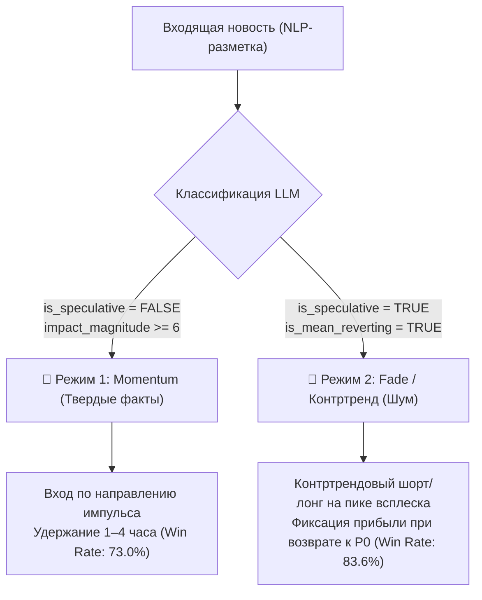

# 📈 Sentix Market Evaluator (`sentix-evaluator`) — Event Study Service

Микросервис количественного анализа рыночной реакции котировок на опубликованные новости **Sentix** (Event Study Analysis) и валидации точности прогнозов LLM на биржевых данных Binance.

---

## 🎯 Назначение

1. **Валидация прогнозов LLM (Directional Alignment):** сопоставляет предсказанный сентимент (`bullish`/`bearish`) с реальным направлением котировок на горизонтах +15м, +1ч, +4ч, +24ч и адаптивном целевом горизонте (`target_horizon_hours`).
2. **Анализ инсайдерских утечек (Pre-event Drift):** рассчитывает динамику цены за 4 часа ДО выхода статьи для выявления опережающих движений.
3. **Фиксация импульса и объемов:** вычисляет всплеск торговых объемов в момент новости по сравнению со средним фоновым значением за 4 часа.
4. **Оценка экстремумов и риска:** измеряет максимальный взлет (Run-up) и максимальную просадку (Drawdown) после события.
5. **Тестирование гипотезы отката (Mean Reversion):** проверяет затухание импульса обратно к $P_0$ для новостей, классифицированных моделью как временные спекулятивные всплески.

---

## 📁 Структура сервиса

```text
market-evaluator/
├── sql/
│   ├── fetch_unevaluated_news.sql   # Выборка новостей, ожидающих оценки рынка
│   ├── get_evaluation_stats.sql     # Расчет общей аналитики точности (Win Rate)
│   └── save_market_impact.sql       # Сохранение метрик в news_market_impact
├── tests/
│   ├── test_binance_client.py       # Тесты резолвера тикеров и маппинга символов
│   ├── test_db_integration.py       # Интеграционные тесты с БД
│   └── test_engine.py               # Тесты математики Event Study Engine
├── binance_client.py                # Клиент к публичному API Binance (klines)
├── config.py                        # Pydantic Settings конфигурация сервиса
├── db.py                            # Асинхронный пул PostgreSQL (psycopg3)
├── engine.py                        # Математический движок расчета доходностей и метрик
├── export.py                        # Скрипт выгрузки данных из БД в CSV и JSON
├── main.py                          # CLI-интерфейс и точка входа
├── models.py                        # Pydantic-модели Candle и EventStudyMetrics
├── queries.py                       # Загрузчик внешних .sql файлов
├── worker.py                        # Воркер и оркестратор оценки рыночного влияния
├── Dockerfile                       # Сборка на базе python:3.12-slim + uv
├── pyproject.toml / uv.lock         # Манифест зависимостей и лок-файл uv
└── README.md
```

---

## 🧮 Математика Event Study Engine ([`engine.py`](file:///Users/isnov/Documents/Git/news-analysis/market-evaluator/engine.py))

Для каждой размеченной новости движок выполняет следующие расчеты:

1. **Базовая цена ($P_0$):** цена закрытия 15-минутной свечи, максимально близкой к моменту публикации статьи $t_0$.
2. **Pre-event Drift (Утечка):**
   $$\text{PreDrift} = \frac{P_0 - P_{\text{open\_pre}}}{P_{\text{open\_pre}}} \times 100\%$$
   *(по свечам за 4 часа до события)*.
3. **Volume Surge Ratio:**
   $$\text{SurgeRatio} = \frac{V_{t_0}}{\bar{V}_{\text{pre}}}$$
   *(отношение объема на новости к среднему фоновому объему за 4 часа)*.
4. **Сетка доходностей:** $R_{15m}, R_{1h}, R_{2h}, R_{4h}, R_{8h}, R_{24h}$ от цены $P_0$.
5. **Экстремумы:**
   * $\text{Max Run-up} = \frac{\max(High) - P_0}{P_0} \times 100\%$
   * $\text{Max Drawdown} = \frac{\min(Low) - P_0}{P_0} \times 100\%$
   * $\text{Volatility Range} = \frac{\max(High) - \min(Low)}{P_0} \times 100\%$
6. **Валидация гипотез:**
   * `is_impulse_confirmed`: подтверждение первичного импульса в первые 2 часа сверх нейтрального порога ($\pm 0.2\%$).
   * `is_target_horizon_aligned`: совпадение направления доходности на целевом горизонте (`target_horizon_hours`) с вектором модели. При `is_mean_reverting=True` проверяется возврат к $P_0$ ($\le 0.3\%$).

---

## 🔬 Квантитативные результаты и торговые режимы (Эмпирическая валидация)

Анализ первого среза данных рыночной валидации ($n = 128$ оценок по 87 уникальным новостям) выявил четкую сегментацию рыночной микроструктуры:

| Метрика | Значение | Статистическая значимость |
| :--- | :--- | :--- |
| **Всего оценок (`total_evaluations`)** | `128` | Репрезентативная выборка |
| **Оценено уникальных статей (`total_news_evaluated`)** | `87` | Различные классы активов (BTC, ETH, SOL...) |
| **Фактические события (`factual_evals`)** | `73` | Подтвержденные новости и релизы |
| **Спекулятивные события (`speculative_evals`)** | `55` | Слухи, прогнозы аналитиков, эссе |
| **Средний всплеск объема (`avg_volume_surge`)** | `1.03x` | Локальное повышение активности |
| **Общий Win Rate импульса (`total_impulse_win_rate_pct`)** | `36.7%` | Весь массив данных без фильтрации |
| **Win Rate импульса на фактах (`factual_impulse_win_rate_pct`)** | `52.1%` | Факты подтверждают движение чаще шума |
| **Win Rate импульса на спекуляциях (`speculative_impulse_win_rate_pct`)**| **`16.4%`** | **83.6% импульсов угасают и откатывают обратно** ($p = 0.000017$) |
| **Win Rate сильных фактов (`factual_strong_signal_win_rate_pct`)** | **`73.0%`** | **Высокое математическое ожидание** ($p = 0.00257$) |

### Два дуальных торговых режима:



1. **Режим Momentum (Твердые факты):**
   * **Условия:** `is_speculative = FALSE`, `impact_magnitude >= 6`, `confidence >= 0.7`.
   * **Точность:** **73.0%** ($Z = 2.80, p = 0.00257$).
   * **Экономический смысл:** Рыночные участники переоценивают баланс спроса и предложения на фундаментальных катализаторах (решения ФРС, одобрение ETF, эксплойты протоколов, листинги). Импульс носит устойчивый направленный характер.
2. **Режим Fade / Mean Reversion (Спекулятивный шум):**
   * **Условия:** `is_speculative = TRUE`, `is_mean_reverting = TRUE`.
   * **Вероятность отката:** **83.6%** (прямой импульс выживает лишь в 16.4% случаев, $Z = 4.15, p = 0.000017$).
   * **Экономический смысл:** Новости с заголовками «аналитик предсказал BTC по $150k», авторские эссе и слухи вызывают кратковременный эмоциональный всплеск розничных трейдеров. Этот объем мгновенно поглощается лимитными ордерами институциональных маркетмейкеров, после чего котировки возвращаются к $P_0$.

---

## 🌐 Интеграция с Binance ([`binance_client.py`](file:///Users/isnov/Documents/Git/news-analysis/market-evaluator/binance_client.py))

* **Публичный REST API:** обращение к `/api/v3/klines` без API-ключей.
* **Резолвинг символов:** автоматическое приведение тикеров к парам `USDT` (например, `BTC` $\to$ `BTCUSDT`, `SOL` $\to$ `SOLUSDT`).
* **Алиасы и словарь:** поддержка полных названий через `KNOWN_TICKER_MAP` (`BITCOIN` $\to$ `BTCUSDT`, `RIPPLE` $\to$ `XRPUSDT`).
* **Черный список:** отсечение некриптовалютных тикеров и макро-индексов (`SPY`, `NVDA`, `COIN`, `TOTAL_CRYPTO`).
* **Отказоустойчивость:** экспоненциальные повторы при сетевых сбоях через библиотеку `tenacity`.

---

## ⚙️ Конфигурация ([`config.py`](file:///Users/isnov/Documents/Git/news-analysis/market-evaluator/config.py))

| Переменная | По умолчанию | Описание |
| :--- | :--- | :--- |
| `POSTGRES_HOST` | `localhost` | Хост базы данных PostgreSQL |
| `POSTGRES_PORT` | `5432` | Порт PostgreSQL |
| `POSTGRES_USER` | `trader` | Пользователь БД |
| `POSTGRES_PASSWORD` | *(Обязательно)* | Пароль БД |
| `POSTGRES_DB` | `crypto_news` | Имя базы данных |
| `BINANCE_BASE_URL` | `https://api.binance.com` | URL публичного API Binance |
| `HTTP_TIMEOUT_SECONDS` | `15.0` | Таймаут запросов к API |
| `PRE_WINDOW_HOURS` | `4` | Пре-событийное окно анализа фона и утечек (часы) |
| `POST_WINDOW_HOURS` | `24` | Пост-событийное окно анализа динамики (часы) |
| `CANDLE_INTERVAL` | `15m` | Таймфрейм свечей (15m, 1h) |
| `NEUTRAL_THRESHOLD_PCT` | `0.2` | Порог отсечения нейтрального движения ($\pm 0.2\%$) |
| `BATCH_SIZE` | `5` | Пачка новостей при пакетной оценке |
| `POLL_INTERVAL_SECONDS` | `30` | Интервал проверки новых новостей в режиме демона |

---

## 🛠 Запуск и использование CLI ([`main.py`](file:///Users/isnov/Documents/Git/news-analysis/market-evaluator/main.py))

### 1. Детальная оценка новости по ID
```bash
uv run python main.py --news-id 18643
```

### 2. Пакетная оценка очереди
```bash
uv run python main.py --batch --limit 50
# или через Makefile:
make eval-batch
```

### 3. Просмотр институциональной статистики точности (Win Rate)
```bash
uv run python main.py --stats
# или через Makefile:
make eval-stats
```

### 4. Непрерывный демон
```bash
uv run python main.py --daemon
# или через Makefile:
make eval-run
```

---

## 📦 Экспорт данных в CSV и JSON ([`export.py`](file:///Users/isnov/Documents/Git/news-analysis/market-evaluator/export.py))

Скрипт формирует выгрузку данных из БД в папку `./exports/`:

```bash
# Экспорт всех 3 датасетов (raw_news, market_impact, combined):
make db-export
# или
uv run python export.py --output-dir ./exports

# Экспорт только объединенной таблицы (статья + сентимент + рынок):
make db-export-combined
# или
uv run python export.py --only combined --output-dir ./exports
```

---

## 🧪 Запуск тестов

```bash
make test-eval
# или
cd market-evaluator && uv run pytest -v
```
